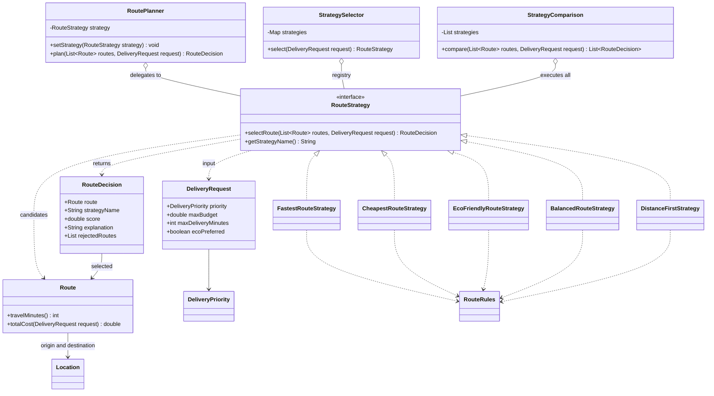
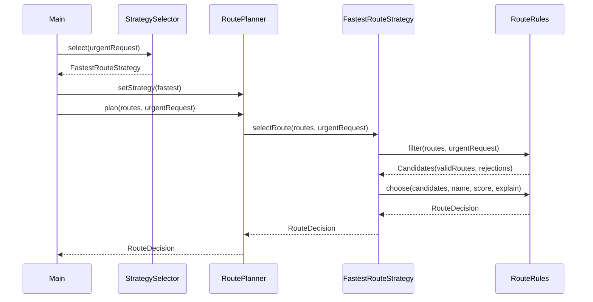

# Assignment 5 — Smart Delivery and Route Optimization

A Java 17 console application that selects a delivery route using the Strategy pattern. It uses eight predefined candidate routes and five interchangeable algorithms. The project intentionally keeps everything in one package, with no database, web server, or external routing API.

## Run

Requirements: JDK 17 or newer and Maven 3.9 or newer.

```sh
mvn clean verify
java -jar target/delivery-strategy-1.0.0.jar
```

Run only the strategy comparison:

```sh
java -jar target/delivery-strategy-1.0.0.jar --compare
```

In IntelliJ IDEA, open `pom.xml` as a Maven project, choose a JDK 17+ project SDK, and run `delivery.Main`. Run the Maven `verify` lifecycle or `RouteEngineTest` to execute the tests. The application has no interactive input; edit `DemoData` or the requests in `Main` to try other scenarios.

## Architecture and Strategy pattern

The problem is that different deliveries need different definitions of the best route. The Strategy pattern puts each selection algorithm behind the same interface so the planner can change algorithms at runtime.

| Responsibility | Class |
| --- | --- |
| Context that delegates planning | `RoutePlanner` |
| Strategy abstraction | `RouteStrategy` |
| Concrete algorithms | `FastestRouteStrategy`, `CheapestRouteStrategy`, `EcoFriendlyRouteStrategy`, `BalancedRouteStrategy`, `DistanceFirstStrategy` |
| Select an algorithm from a request | `StrategySelector` |
| Shared hard constraints and deterministic selection | `RouteRules` |
| Domain data | `Location`, `Route`, `DeliveryRequest`, `DeliveryPriority` |
| Selected route, score, explanation, and rejection reasons | `RouteDecision` |
| Execute a list of algorithms for the same request | `StrategyComparison` |
| Console demonstration and sample data | `Main`, `DemoData` |

`RouteStrategy.selectRoute` returns `RouteDecision` rather than just `Route`. This small change to the suggested interface keeps the selected route together with its explanation and rejected candidates. Callers do not need to recalculate or guess why a route won.

`RoutePlanner.plan` calls `strategy.selectRoute`. It has no algorithm names, concrete strategy imports, `instanceof` checks, or algorithm-selection switch. This is Strategy because the algorithm is an interchangeable object; an `if/else` chain inside the planner would require editing the planner for every new algorithm.

The full demo reuses one planner and calls `setStrategy` four times: fastest → cheapest → eco → balanced → distance first. `samePlannerSupportsThreeRuntimeSwitches` also verifies the three original switches.

### Strategy versus strategy selection

A strategy decides **how** to rank eligible routes. `StrategySelector` decides **which algorithm** matches the business request using a configurable map:

| Request priority | Default strategy |
| --- | --- |
| `URGENT` | Fastest |
| `ECONOMY` | Cheapest |
| `ECO` | Eco friendly |
| `STANDARD` | Balanced |

`ecoPreferred = true` selects eco delivery unless the priority is urgent. Urgency takes precedence. A different map can be passed to the selector constructor, including a mapping to the fifth strategy, without changing the planner. Missing mappings cause a clear exception.

## Constraints and formulas

Every strategy first calls the shared constraint filter. A route must be available, have total cost **at most** the request budget, and have time including traffic **at most** the deadline. The filter records every violation. Scoring considers only eligible routes, and equal scores are resolved by ascending route ID.

Costs use arbitrary currency units, time uses minutes, distance uses km, and emissions use kg CO2.

```text
finalTime = estimatedMinutes + trafficMinutes

totalCost = baseCost + distanceKm * 0.50 + tollFee + prioritySurcharge
prioritySurcharge = 10 for URGENT, otherwise 0

fastestScore = finalTime
cheapestScore = totalCost
ecoScore = carbonEmission * 0.80 + distanceKm * 0.20
distanceFirstScore = distanceKm
```

`Route.totalCost` holds the common cost formula so cheapest scoring and budget filtering always use the same price. The eco formula belongs inside `EcoFriendlyRouteStrategy` because it defines that algorithm's environmental policy. Its coefficients are illustrative policy coefficients for kg and km, rather than normalized percentages or a scientific emissions model.

Balanced scoring normalizes each metric over **eligible routes only**:

```text
normalized(value) = (value - minimum) / (maximum - minimum)
normalized(value) = 0 when maximum == minimum

balancedScore = normalized(finalTime) * timeWeight
              + normalized(totalCost) * costWeight
              + normalized(distanceKm) * distanceWeight
              + normalized(carbonEmission) * emissionWeight
```

Default weights are `(0.40, 0.30, 0.10, 0.20)`. Each must be finite and between 0 and 1, and their sum must equal 1 within `1e-9`. The constructor rejects invalid configurations. Identical metrics, including the single-candidate case, contribute zero without division by zero. Lower scores win for all algorithms. Scores from different algorithms use different scales and should not be compared numerically with each other.

### Failure handling

- Empty candidates or no eligible route: `NoSuitableRouteException`, including rejection reasons when candidates exist.
- Negative or non-finite domain metrics, invalid coordinates, negative budget/deadline, or invalid weights: `IllegalArgumentException`.
- Missing request, route, priority, or strategy: `NullPointerException` with an explicit message.

`Main` demonstrates the first two no-route cases and invalid weights. Unavailable routes appear in the comparison's rejection output. Zero budget/deadline and equality at both limits are allowed.

## UML class diagram



## UML sequence diagram

This follows the urgent-request iteration in `Main`, after its planner and selector have been created.



## Example console output

Selected lines from the full demo:

```text
SMART DELIVERY - 8 candidate routes
Comparison: STANDARD, budget 100.00, deadline 60 min
Fastest -> R2-Highway | time 20 min | cost 67.50 | distance 25.0 km | CO2 9.0 kg | score 20.000
Cheapest -> R3-Economy | time 42 min | cost 18.00 | distance 20.0 km | CO2 5.0 kg | score 18.000
Eco friendly -> R4-Electric | time 32 min | cost 28.00 | distance 16.0 km | CO2 0.8 kg | score 3.840
Balanced -> R6-Balanced | time 27 min | cost 25.00 | distance 14.0 km | CO2 2.0 kg | score 0.210
Distance first -> R5-Short | time 45 min | cost 23.00 | distance 10.0 km | CO2 3.0 kg | score 10.000
Reason: Minimum distance among eligible routes: 10.0 km
Rejected R7-Closed: unavailable
Rejected R8-Premium: budget exceeded

Same fastest strategy, budget 100 -> R2-Highway
Same fastest strategy, budget 25 -> R6-Balanced
Empty routes: No candidate routes supplied
Invalid weights: Weights must be finite, nonnegative and sum to 1.0
```

The complete output includes a reason and rejection list for every strategy, four runtime switches, automatic request selection, and the no-valid-route failure.

## Tests

Verified with JDK 21 targeting Java 17 bytecode, Maven, and JUnit 5.11.4:

```text
mvn clean verify
Tests run: 34, Failures: 0, Errors: 0, Skipped: 0
BUILD SUCCESS
```

The suite covers all five algorithms, traffic, the cost formula, weight configuration and normalization, three runtime switches, all priority mappings, eco preference, custom mappings, budget changes, deadline filtering, rejection explanations, impossible and empty candidate sets, invalid weights/data, missing inputs, and comparison results. Parameterized tests exercise constraint filtering and exact budget/deadline boundaries against every strategy. Both console modes were also run from the packaged JAR.

## Adding a strategy and Git history

Implement `RouteStrategy`, reuse `RouteRules.filter` and `RouteRules.choose` for consistent constraints and explanations, and register the instance in `DemoData.strategies()` for the demo and comparison. Optionally pass a custom mapping to `StrategySelector`. No planner change is needed.

The original four-strategy app was run and passed 31 tests before adding `DistanceFirstStrategy`. Commit `88cc3dc` adds that fifth algorithm and its tests. It changes only **one existing production class**, `DemoData`, to register the new instance; `RoutePlanner`, the selector, and the comparison runner remain unchanged.

The history records separate commits for domain setup, the abstraction and constraints, each original algorithm, the context/comparison, the selector, the working demo, tests, the fifth strategy, and this report. Inspect it with:

```sh
git log --oneline --reverse
git show --stat 88cc3dc
```

## SOLID, Bridge comparison, and limitations

- **SRP:** the planner delegates; strategies rank; the selector applies business mappings; shared rules enforce eligibility; `Main` handles presentation.
- **OCP:** the fifth strategy extends behavior through the interface while leaving the planner and comparison runner unchanged.
- **DIP:** `RoutePlanner` holds a `RouteStrategy` abstraction rather than a concrete algorithm.

Strategy replaces an algorithm for one responsibility at runtime. Bridge separates an abstraction and an implementation so two dimensions can evolve independently. Here the changing dimension is route-selection policy, so Strategy fits. A Bridge design could instead separate a delivery service abstraction from different transport-provider implementations; that would solve a different design problem.

This app ranks supplied routes; it does not calculate paths through a road network or optimize multiple deliveries together. All candidates are assumed to connect the same origin and destination. Traffic and emissions are static estimates, prices use `double`, and changing the eligible set can change balanced normalization. New priority enum values or business-preference rules still need explicit configuration or selector changes. The planner is mutable and intended for a single-threaded console demo.

For submission, use the public repository URL and this README as the report. Moodle upload and the individual defense are separate submission steps.
